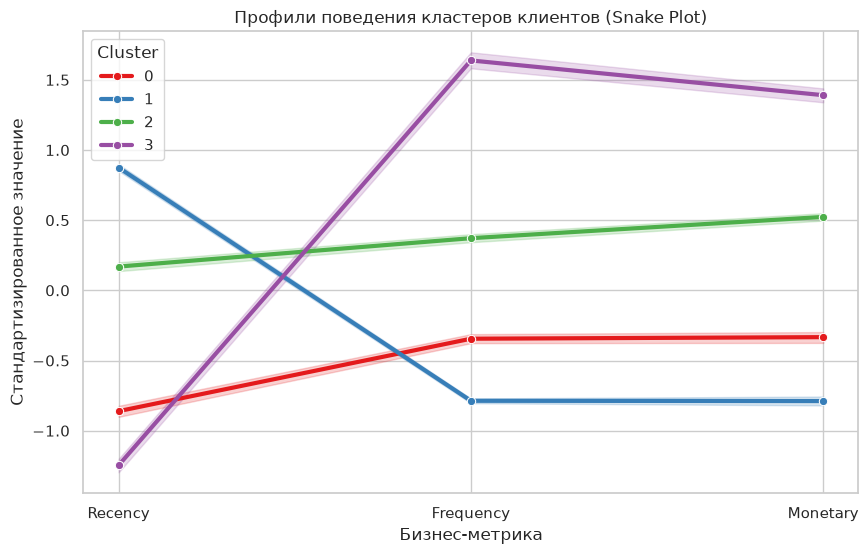

# E-Commerce Customer Segmentation & RFM-Clustering

An end-to-end data analytics and machine learning engineering project focused on **customer segmentation** and **behavioral analysis** for a UK-based online retailer. 

The project demonstrates a production-grade analytical approach: from data engineering and anomaly filtering to mathematical scaling, unsupervised learning (**K-Means Clustering**), and business insight extraction.


## Tech Stack & Project Architecture
- **Language:** Python (Pandas, NumPy, Scikit-Learn)
- **Environment:** Visual Studio Code & Jupyter Notebooks
- **Database Tooling:** DBeaver (SQL-ready data mart schema definition)
- **Visualization:** Seaborn, Matplotlib

```text
my_ecommerce_project/
├── data/
│   ├── data.csv                 # Raw dataset from Kaggle (~500k rows)
│   └── rfm_segmented_data.csv   # Final production-ready labeled dataset
├── sql/
│   ├── 01_data_cleaning.sql     # Production SQL script for data preparation
│   └── 02_rfm_view.sql          # SQL view for Recency, Frequency, Monetary calculation
├── notebooks/
│   └── rfm_analysis.ipynb       # Main Jupyter notebook (EDA, Transformation, Modeling)
└── README.md                    # Project presentation
```

---

## Step 1: Data Engineering & Anomaly Cleaning
Standard public notebooks often oversimplify data cleaning. In this project, data quality was treated as a priority:
1. **Customer Linkage:** Filtered out records with missing `CustomerID` as they cannot be tracked sequentially.
2. **True Return Accounting:** Negative quantities (`Quantity < 0`) were **not** blindly deleted. Instead, they were mathematically retained in the transaction stream to correctly net out against total spending, preventing *Monetary* skew.
3. **Infrastructure Cleanup:** Discarded service codes (`POST`, `BANK CHARGES`, `CRUK`, etc.) to isolate purely commercial item sales.

---

## Step 2: Mathematical Transformations (The ML Level)
Real-world e-commerce data follows the **Pareto Principle**, resulting in extreme right-skewness ("heavy tails") due to bulk B2B buyers.
- **Log Transformation (`np.log1p`):** Applied to pull long financial tails back into a normal distribution, preventing metric algorithms from distorting distances.
- **Scaling (`StandardScaler`):** Standardized features ($Recency$, $Frequency$, $Monetary$) to a zero-mean scale, ensuring that different physical units (days vs. currency) hold equal weight during distance optimization.

---

## Step 3: Determining Optimal Clusters
Rather than guessing the number of customer groups, I combined two validation techniques:
- **The Elbow Method (Inertia):** Located the visible inflection point.
- **Silhouette Coefficient:** Evaluated the mathematical boundaries between clusters, achieving a strong local peak at **$k = 4$**.

---

## Step 4: Final Segmentation & Business Insights
The dataset was successfully segmented into **4 distinct behavioral groups** (Metrics represent real averaged values):


 


| Cluster | Segment Name | Recency (Days) | Frequency (Orders) | Monetary (Spend) | Client Count | Business Strategy |
| :---: | :--- | :---: | :---: | :---: | :---: | :--- |
| **3** |  **Champions (VIP)** | **11.0** | **16.4** | **£7,543.1** | **712** | Reward them. No cheap discounts. Introduce loyalty tiers, personal managers, and early access. |
| **2** |  **At Risk (Loyal Sleeping)** | **71.3** | **4.9** | **£1,676.3** | **1,121** | **Primary Analytical Focus.** Win them back before they churn. Send reactivation offers and personalized discounts. |
| **0** |  **Promising Newbies** | **16.6** | **2.5** | **£585.1** | **854** | Nurture them. Trigger post-purchase onboarding emails and provide discounts for their next (4th) order. |
| **1** |  **Hibernating (Churn)** | **177.2** | **1.5** | **£334.5** | **1,638** | Low-cost automation only. Do not waste expensive remarketing budget. Send a final low-cost automated email survey. |

---

## Key Business Findings & Recommendations
1. **The Core 16%:** *Champions* make up only ~16% of the customer base but generate the vast majority of net revenue. Securing their retention is critical.
2. **The Leaking Bucket:** Over 1,100 high-value customers are in the *At Risk* segment (unseen for 70+ days). Implementing a trigger-based retention system can save the company thousands in potential lost revenue.
